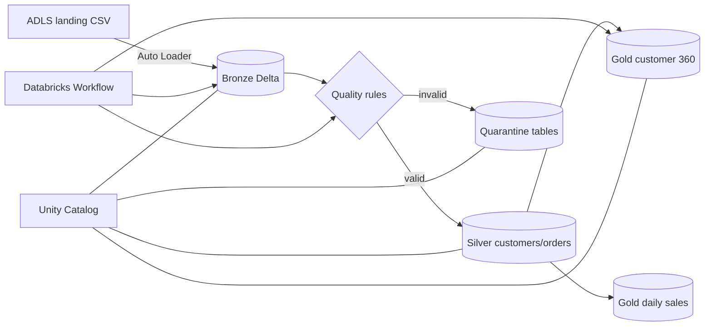

# Lakehouse Circuit: Production-Ready Azure Databricks ETL

An end-to-end medallion architecture tutorial using Azure Data Lake Storage Gen2, Azure Databricks, Unity Catalog, Auto Loader, Delta Lake, data-quality quarantine, Workflows, and Databricks Asset Bundles.

Created by [Lakehouse Circuit](https://www.youtube.com/@LakehouseCircuit). The sample data is entirely synthetic.

## Architecture



## Existing Azure resources

| Resource | Value |
|---|---|
| Resource group | `rg-lakehouse-circuit-dev` |
| Databricks workspace | `adb-lakehouse-circuit-dev` |
| Unity Catalog catalog | `adb_lakehouse_circuit_dev` |
| Storage account | `stlakecircuitdev01` |
| Landing location | `abfss://landing@stlakecircuitdev01.dfs.core.windows.net/` |
| Checkpoint location | `abfss://checkpoints@stlakecircuitdev01.dfs.core.windows.net/` |
| Storage credential | `cred_lakehouse_circuit_dev` |

## Repository layout

```text
data/                 Synthetic CSV input, including intentional bad records
resources/            Databricks Workflow definition
sql/                  Reproducible Unity Catalog setup
src/                   Bronze, Silver and Gold pipeline notebooks
tests/                 Local unit tests for quality rules
databricks.yml         Databricks Asset Bundle configuration
recording-script.md    Video narration and on-screen directions
youtube-metadata.md    Title, description, chapters and thumbnail brief
```

## 1. Upload the sample data

In Azure Portal, open the `landing` container and create folders named `customers` and `orders`. Upload:

- `data/customers_2026-10-27.csv` to `landing/customers/`
- `data/orders_2026-10-27.csv` to `landing/orders/`

The final paths should be:

```text
abfss://landing@stlakecircuitdev01.dfs.core.windows.net/customers/customers_2026-10-27.csv
abfss://landing@stlakecircuitdev01.dfs.core.windows.net/orders/orders_2026-10-27.csv
```

## 2. Run interactively first

In Databricks choose **New → Notebook → Import**, then import the Python files from `src/`. Run them on Serverless in this order:

1. `01_bronze_ingestion.py`
2. `02_silver_quality.py`
3. `03_gold_aggregates.py`

Each notebook accepts `catalog` and `reset_checkpoint` widgets. Leave the catalog at its default. Set `reset_checkpoint` to `true` only when replaying the tutorial data from scratch.

Verify the results in SQL Editor:

```sql
SELECT 'bronze_customers' AS table_name, count(*) AS rows FROM adb_lakehouse_circuit_dev.bronze.customers
UNION ALL SELECT 'bronze_orders', count(*) FROM adb_lakehouse_circuit_dev.bronze.orders
UNION ALL SELECT 'silver_customers', count(*) FROM adb_lakehouse_circuit_dev.silver.customers
UNION ALL SELECT 'silver_orders', count(*) FROM adb_lakehouse_circuit_dev.silver.orders
UNION ALL SELECT 'quarantine_customers', count(*) FROM adb_lakehouse_circuit_dev.quarantine.customers
UNION ALL SELECT 'quarantine_orders', count(*) FROM adb_lakehouse_circuit_dev.quarantine.orders;
```

## 3. Deploy as a Databricks Asset Bundle

Install and authenticate the Databricks CLI, then copy your workspace URL from Databricks and run:

```powershell
databricks auth login --host https://<your-workspace-url>
databricks bundle validate -t dev
databricks bundle deploy -t dev
databricks bundle run lakehouse_circuit_etl -t dev
```

Both targets deploy with the schedule paused for safety. The configured schedule is 06:00 Monday–Friday in `Europe/London`. After reviewing a production deployment, change its `schedule_status` to `UNPAUSED` deliberately.

## Local tests

```powershell
python -m pip install -e ".[dev]"
python -m pytest -q
```

## Data-quality rules

Customers are quarantined when the customer ID or name is missing, the email is malformed, the country code is not two letters, or the signup date is invalid. Orders are quarantined for missing IDs, unknown customers, non-positive quantities/amounts, unsupported statuses, invalid timestamps, or duplicate order IDs.

Valid rows are deduplicated by business key using the latest `_ingested_at` value. Invalid rows retain `_quality_errors`, `_source_file`, and `_ingested_at` for investigation and replay.

## Cost and safety

- Use serverless compute and stop unused SQL warehouses.
- Keep the development schedule paused until validation is complete.
- Do not commit credentials, access keys, tokens, subscription IDs, or workspace URLs.
- The included data is synthetic and contains no personal information.

## License

Released under the [MIT License](LICENSE).

